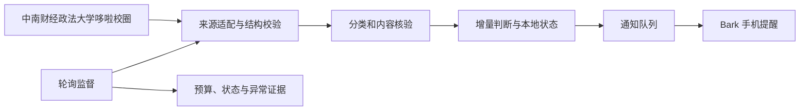

# 哆啦校圈监控

> 面向中南财经政法大学哆啦校圈的悬赏信息监测与手机提醒工具。

[快速体验](#快速体验) · [Windows 使用指南](docs/使用指南.md) · [项目结构](#项目结构)

哆啦校圈上的悬赏信息有时效。哆啦校圈监控帮助用户减少反复刷新：在设定范围内检查更新，核验帖子是否符合悬赏提醒条件，记录已观察内容，并把符合条件的提醒发送到手机。

它把“发现—核验—去重—提醒—状态查看”连成一条流程，让提醒更有依据，也让后台运行和异常状态看得见。

## 面向用户的价值

| 用户需求 | 产品体验 | 实现方式 |
| --- | --- | --- |
| 少盯屏幕、少手动刷新 | 按设定间隔检查目标信息 | 控制扫描范围、分页数量与请求预算 |
| 减少无关提醒 | 只在分类证据满足条件时进入提醒判断 | 校验来源字段；缺失或冲突的信息按未知处理 |
| 提醒内容便于判断 | 优先使用已验证的正文或预览 | 标记正文完整性，无法确认时明确降级 |
| 避免重复看到旧帖 | 重新启动后仍能识别已观察和已发送内容 | 使用本地 SQLite 保存观察与通知状态 |
| 后台运行状态可追踪 | 查看运行状态、停止监测并核查异常 | Windows 启停入口与独立进程监督 |

## 工作流程



## 项目结构

| 组件 | 职责 |
| --- | --- |
| [`adapters.py`](campus_watch/adapters.py) | 读取来源分页，校验字段并生成统一记录 |
| [`monitor.py`](campus_watch/monitor.py) | 判断观察结果、基线与提醒资格 |
| [`storage.py`](campus_watch/storage.py) | 保存本地观察状态、通知队列和运行锁 |
| [`body.py`](campus_watch/body.py) | 解析正文并标记完整性 |
| [`notifier.py`](campus_watch/notifier.py) | 组织 Bark 通知并记录投递状态 |
| [`watch.py`](campus_watch/watch.py)、[`supervisor.py`](campus_watch/supervisor.py) | 管理轮询预算、后台进程与运行证据 |

## 快速体验

需要 Python 3.12 和 [uv](https://docs.astral.sh/uv/)。在项目根目录运行：

```powershell
uv sync --locked
uv run --locked python -m campus_watch demo
```

离线演示使用合成帖子和临时数据库，不连接论坛，也不发送通知。查看命令说明：

```powershell
uv run --locked python -m campus_watch --help
```

## Windows 日常使用

首次启动前，请阅读 [Windows 使用指南](docs/使用指南.md)。连接真实来源或发送 Bark 通知前，需要在本机完成配置，并确认访问符合来源平台规则。

## 隐私与运行边界

- 监测状态、数据库和本机推送凭证保存在 `data/`，不会随源码提交。
- 提醒时效受来源更新、检查间隔、网络和推送服务影响；项目不承诺固定到达时间。
- Bark 接受请求不等于手机已收到通知；必要时应查看本地运行状态。
- 项目通过有界扫描、持久状态和显式授权降低误提醒风险，不将外部平台行为包装成确定结果。
